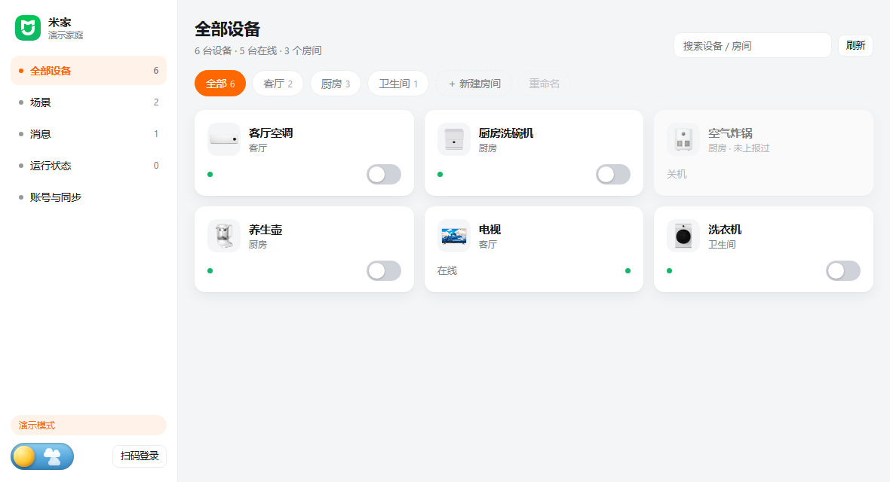
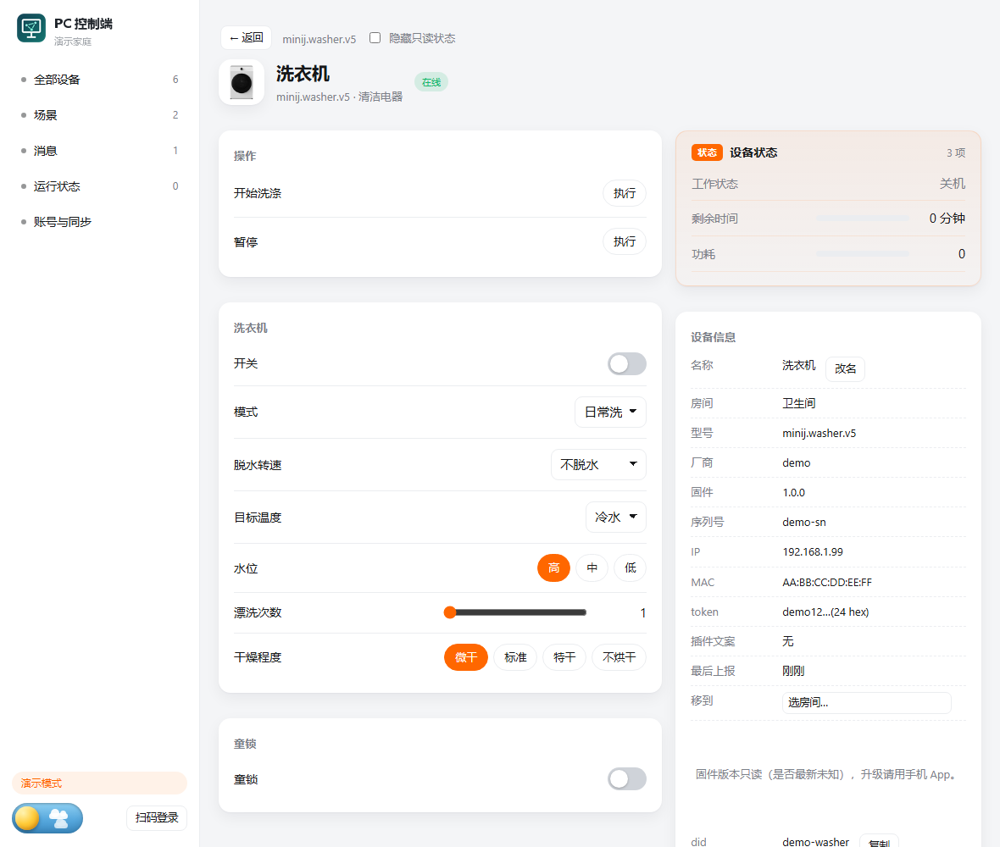
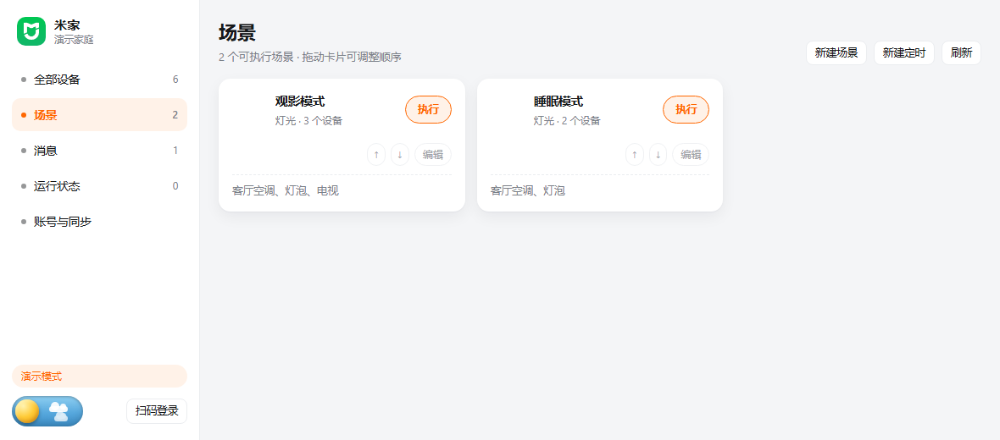
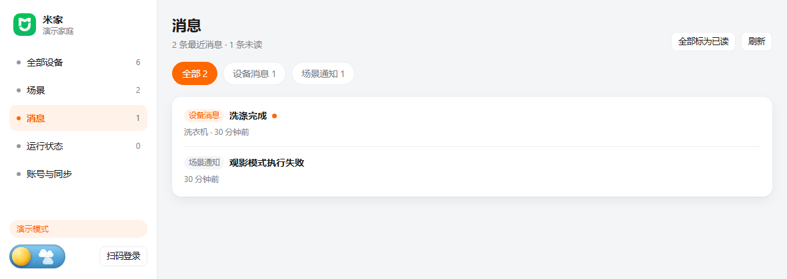

# PC 控制端（非官方米家兼容工具）

> 本项目为**社区独立开发的非官方桌面兼容工具**，与小米公司不存在隶属、授权、合作或背书关系，
> 不替代官方服务。“米家”“Mi Home”“小米”仅用于客观描述兼容对象，相关商标权归其权利人所有；
> 项目名称、原创图标和界面不使用米家标识。
>
> 仅面向个人用户在自有设备上的控制与兼容使用。凭据仅保存在本机，项目不收集凭据，
> 不向作者或无关第三方上传，不提供账号代取 token、批量导入、预置 token 库或抓包辅助，
> 也不规避登录风控、频率限制、设备指纹或其他额外技术防护。必须依赖云端的功能会在文档中如实说明。
>
> 代码依据公开协议资料、功能需求、独立逆向分析与自有账户验证另行编写，不是对反编译代码的翻译式改写；
> 不含小米官方客户端二进制、完整插件包或反编译源码。设计文档与提交历史用于保留独立开发证据。

> 当前为 **0.7.x 公开测试版（Beta）**，不是 1.0 稳定版；设备分页与部分真机兼容性仍需验证。

Windows（Windows 7 SP1 起）与 Linux 上的米家设备控制端：**纯标准库 Python + 手写网页 UI**，
不需要装任何第三方 Python 包，也不依赖 Electron。项目聚焦官方客户端未覆盖的 PC 使用场景。

> 当前版本 **0.7.42**。变更明细见 [CHANGELOG.md](CHANGELOG.md)，功能对照见
> [docs/04-功能对照.md](docs/04-功能对照.md)，逆向笔记在 [docs/reverse/](docs/reverse/)。

---

## 能做什么

| 能力 | 状态 | 说明 |
|---|---|---|
| 设备列表 / 卡片网格 | ✅ | 房间分组、在线状态、开关一眼可见 |
| 设备控制 | ✅ | 由 MIoT spec 自动生成控件（开关/滑杆/枚举/动作），不可用态按规则置灰 |
| 设备详情 | ✅ | 双栏：左控制、右状态与故障码；插件文案自动同步 |
| 设备信息 / 改名 | ✅ | 型号、厂商、固件、序列号、IP、MAC、token（打码）、最后上报；可改名 |
| 房间 | ✅ | 新建 / 重命名 / 删除 / 设备搬家；家庭改名 |
| 场景 | ✅ | 卡片一键执行；**新建（可多动作）与编辑** |
| 定时 / 预约 | ✅ | 列表与启停；**新建、改时间、删除**；每天 / 法定工作日 / 节假日 / 每周选周几 |
| 消息 | ✅ | 按类型的最新消息、未读数、全部标为已读、单条删除、**每台设备的历史消息** |
| 自动化 | ⚠️ | 列表、启停、改名改动作可用；**新建任意触发不可行**（见下文「已知限制」） |
| 添加设备 | — | 按需求**不做**（扫码配网留给手机 App） |
| 账号 | ✅ | 扫码登录后**无需重启**即切到账号数据；「账号与同步」里可**退出登录**（只删本机凭据，不影响手机米家） |

## 界面

下面全部是**演示模式**（未登录）的截图，设备与家庭名都是虚构的：

| 设备列表（spec 自动生成控件） | 设备详情（双栏） |
|---|---|
|  |  |

| 场景（执行 / 编辑 / 拖拽排序） | 消息中心 |
|---|---|
|  |  |

## 下载与安装

**最新版从这里下载** —— [Releases · v0.7.42](https://github.com/shallow-seek-nothing/mihome-pc-unofficial/releases/tag/v0.7.42)

| 平台 | 文件 | 怎么用 |
|---|---|---|
| **Windows 64 位** | `pc-controller-0.7.42-portable-win64.zip` | 解压后双击 `mihome.vbs`；目录里有 `使用须知.txt`，不需要装 Python |
| **Windows 32 位** | `pc-controller-0.7.42-portable-win32.zip` | 同样解压即用；Win7 前置条件见下方实测说明 |
| Windows（安装版） | 解压 zip 后运行 `install.ps1` | 装到 `%LOCALAPPDATA%\Programs\MiHomePC`，桌面自动放快捷方式；`-Quiet` 静默 |
| **Debian / Ubuntu（deb）** | `pc-controller_0.7.42_all.deb` | `sudo apt install ./pc-controller_0.7.42_all.deb`，菜单里出现「PC 控制端 / PC Controller」 |
| **其他 Linux（tarball）** | `pc-controller-0.7.42-linux.tar.gz` | `tar xzf …` 后 `sh install.sh`（或 `--prefix ~/.local`），带 `.desktop` 与多尺寸图标 |

> **32 位支持**：当前版本继续支持 32 位 Windows，并提供独立 win32 便携包；后续更新会尽量延续
> 32 位构建与基础兼容性验证。若运行环境或关键依赖变化影响支持范围，将在发布说明中明确注明。
>
> 绿色版内置 Python 3.8，在满足系统前置条件时**解压即用**；当前是 **0.7.x Beta**，标记为预发布。
>
> **Win7 SP1 实测（0.7.36）**：x64／x86 均已在虚拟机中跑通 Demo。裸 Win7 SP1 需先安装
> UCRT（KB2999226），并按系统安装要求重启；IE8 不支持，已验证 Firefox 115 ESR。
> 本轮覆盖 Demo 服务、接口与界面，不等同于真实账号和真实设备全功能验证。
> 0.7.37 的登录改动与 0.7.38 的品牌、授权及打包改动均未在 Win7 单独复测。
> 详见 [Win7 SP1 x64／x86 实测报告](docs/win7-sp1-compatibility.md)。

### 从旧版升级

**通过「安装到桌面」安装的用户**：退出旧程序，下载并解压新版，双击新包里的
`安装到桌面.cmd` 即可覆盖升级，不需要先卸载。安装器只会结束米家自己的进程，先暂存完整新版，
再替换旧程序；失败时恢复旧版。标准用户数据 `%USERPROFILE%\.mihome-pc` 不会移动或删除，
登录凭据、插件缓存和本地型号目录都会保留，通常不需要重新扫码。

**绿色版用户**：退出旧程序，把新版解压到一个新目录，再将旧程序目录中的整个 `data`
文件夹复制到新版目录，启动新版并确认数据正常后再删除旧目录。不要直接删除唯一的数据副本；
升级前可将 `data` 额外备份一份。

### 从源码跑

```powershell
git clone https://github.com/shallow-seek-nothing/mihome-pc-unofficial.git
cd mihome-pc-unofficial
python -m mihome_pc serve        # 未登录时是演示数据
```

只需要 Python 3.8+，**没有任何第三方依赖**。

运行时的行为**按平台分成两套**（`tray.py` 是 Windows 专属实现，Linux 没有托盘）：

- **Windows**：右下角出现 PC 控制端图标，左键打开界面，**右键可打开数据目录 / 退出**。
- **Linux：没有托盘图标**。`mihome-pc app` / `serve` 前台运行就停在那个终端里，`Ctrl+C` 退出；
  后台启动或者终端已经关了，用 **`mihome-pc stop`** 停（它按数据目录里的 `app.lock` 找进程，
  顺手清理过期锁）。关掉浏览器窗口不会结束服务——服务和窗口是解耦的，要退就用 `stop`。

## 登录与退出登录

* 点右上角「扫码登录」，用米家 App 扫码。**确认后界面会自动切到账号数据，不用重启、
  也不用手动刷新**；过渡页会显示账号与设备加载进度，失败时给出原因并可重试。
  凭据写在数据目录的 `credentials.json`，下次启动自动登录。
* 换账号 / 退出：侧栏「账号与同步」→「退出登录」（点两下确认）。它只删**本机**凭据，
  不吊销 `passToken`，手机上的米家 App 不受影响；退出后立刻回到演示模式。
* 0.7.36 及以前的**新装用户**扫码后仍停在演示模式（issue #1：进程只在启动时读一次凭据），
  那条「手动刷新一次」的土办法其实只有重启才起作用。0.7.37 已修，升级即可。
* 0.7.42 修复会话 Cookie 未合并、302 中间响应的 `serviceToken` 未读取，以及旧 `location`
  换取失败后的回退；真实扫码、凭据刷新和设备列表加载均已验证。
* 凭据文件损坏时界面会显示「凭据文件无法读取，请重新扫码登录」，不再是白屏或整页报错。

## 命令行

```powershell
python -m mihome_pc app          # 桌面模式：浏览器 app 窗口 + Windows 托盘
python -m mihome_pc serve        # 只起本地网页（未登录时是演示数据）
python -m mihome_pc stop         # 停掉在跑的实例（Linux 唯一退出方式；读 app.lock）
python -m mihome_pc login        # 扫码登录，凭据存 ~/.mihome-pc/credentials.json
python -m mihome_pc devices      # 列出设备
python -m mihome_pc view DID     # 打印该设备 spec 生成的控件
python -m mihome_pc probe DID    # 可用性矩阵探测（默认演练，--commit 才写入）
python -m mihome_pc selftest     # 离线自检（不需要账号）
python -m mihome_pc selftest --env   # 附带数据目录/凭据/spec/插件文案的状态
```

装成 deb/tarball 之后，命令就是 `mihome-pc app` / `mihome-pc serve` / `mihome-pc stop`
（launcher 会把请求转给系统的 `python3`；`MIHOME_PC_PYTHON` 可指定解释器）。

## 日志与排障

日志统一写在数据目录的 `logs/mihome-pc.log`（默认 2 MiB 滚动、留 5 份），一行一条：

```
2026-11-26T19:26:15.007+08:00 WARNING web      ec383171 api GET /api/device -> 400: did required
```

时间（ISO8601，带毫秒与时区）/ 级别 / 模块 / 请求 id / 正文。失败弹框里显示的
「请求 ID」与这一行的 `ec383171` 是同一个值，用户贴出来就能直接定位这一次请求。

* `mihome-pc --log-level debug serve`（或 `MIHOME_PC_LOG_LEVEL=debug`）打开详细日志，默认 `info`
* 失败不再是一闪而过的 toast，而是一个**诊断框**：哪个操作失败、人话说明、
  请求 ID / HTTP 状态 / 错误码 / 接口路径，以及一键「复制诊断信息」
* `mihome-pc report` 把日志与系统信息打成一个 zip（**不含凭据、不含设备 token**），
  报 bug 时只发这一个文件
* 未捕获异常写到 `logs/crash-<时间>.log`（pythonw 下没有控制台，这是唯一现场）；
  `mihome-pc selftest --env` 会列出日志路径、当前级别、崩溃记录数
* 密钥（`serviceToken` / `passToken` / 设备 token / Cookie / Bearer）在写盘前统一打码成
  `a1b2…(32)`；**错误码与 did 不脱敏**，否则没法排障
* 崩溃回溯、stderr、Windows 启动异常走同一脱敏规则；`report` 打包旧日志时再过滤一次，
  真实 token 别名、单引号字典、转义 JSON、短密码与登录 ticket 也有对抗回归覆盖

细节见 [docs/05-日志与排障.md](docs/05-日志与排障.md)。

网页支持深链接：`/?did=<did>` 设备页、`/?view=scenes`、`/?view=messages`、
`/?view=account`、`/?room=客厅`、`/?theme=dark`。

键盘：`/` 聚焦搜索、`Esc` 关闭弹窗/返回列表、搜索框里 `Enter` 直接打开唯一匹配的设备。

想看看「空账号」长什么样：`MIHOME_PC_DEMO_EMPTY=1 python -m mihome_pc serve`。

## 型号名与卡片布局（可选，本地生成）

**默认界面是通用的**：设备名用设备自己的 `model` 字段（例如 `minij.washer.v5`），
卡片使用通用布局。仓库与安装包**不包含**中文型号目录和逐型号卡片布局——那两份额外数据来自米家安装包，
本项目没有再分发权（见 [THIRD_PARTY_NOTICES.md](THIRD_PARTY_NOTICES.md) 风险 1）。

如果你拥有米家安装包，可以**在你自己的机器上**生成，仅本机使用、不要公开再分发：

```powershell
python tools\make_catalog.py          # -> <数据目录>\catalog\catalog.json
python tools\make_card_layouts.py     # -> <数据目录>\catalog\card_layouts.json
```

* 数据目录默认 `%USERPROFILE%\.mihome-pc`（绿色版为程序目录旁的 `data\`）；
* 程序**优先加载**该目录里的文件，没有就自动用通用界面；
* **升级安装不会删除**这些文件（安装脚本只覆盖程序目录，数据目录保持不动）；
* 生成的 JSON 请不要提交到公开仓库或再次分发。

## 许可证与使用边界

自 **0.7.38** 起，本项目自有内容采用 **PolyForm Noncommercial 1.0.0**，版权人
**shallow-seek-nothing**。允许个人及其他非商业目的使用、修改和分发；商业使用需要另行取得权利人的授权。
完整条款见 [LICENSE](LICENSE)。本项目从此属于**源码可见的非商业许可软件**，不再称为 OSI 意义上的开源软件。

**0.7.37 及更早版本仍适用 MIT**，旧许可证保留在 [LICENSES/MIT.txt](LICENSES/MIT.txt)；
本次切换不追溯撤销旧版本已经授予的权利。两个历史 Git 署名 `MolaChat` 与
`shallow-seek-nothing` 已经版权人确认为同一人。

项目许可证只覆盖作者拥有权利的原创代码、测试、原创文档与原创图标。第三方资源的来源与边界见
[THIRD_PARTY_NOTICES.md](THIRD_PARTY_NOTICES.md)；NOTICE 用于说明权利边界，**不是授权，也不能替代授权**。
内嵌 CPython 等第三方组件继续适用其原许可证。

本项目不嵌广告、不做付费增值、不提供收费商业支持，也不接受与功能挂钩的捐赠。

> 本项目按“现状”提供，不提供任何明示或默示担保；使用者应自行评估设备控制、账号和系统兼容性风险。
> 免责声明不构成对任何依法应承担责任的豁免。运行时下载的插件文案仅缓存在本地 `data/` 目录，
> 不随仓库或安装包分发。

## 已知限制（与 `docs/04-功能对照.md` 一致，都写清楚了，不假装支持）

1. **设备列表只请求一页**（`limit=200`）：超过 200 台可能静默缺失；分页游标仍需协议证据与真机验证。
2. **场景 / 定时的新建依赖账号里已有一条同类场景作模板**（服务端校验 `sc_id` 与动作信封，手拼会被 `-998` 拒）；
   空账号是明确降级提示，**不是无条件新建**。执行与编辑不受影响。
3. **参数动作**：设备详情页能按 spec 生成 inline 输入并下发；**场景 / 定时编辑器不支持带参数动作**
   ——前端不列出、后端在写云端之前拒绝（fail-closed）。
4. **inline 动作的真机边界**：随包夹具没有 inline 动作，合成夹具通过**不等于**所有真实型号已验证。
5. **「下次执行时间」**：每天/每周精确；工作日按周一至周五估算，**未计法定节假日与调休**；
   法定节假日**不显示本地确定日期**（由云端判定）。
6. **自动化任意触发**、**新消息实时推送**、**添加设备**仍然不做，理由见 `docs/阶段总结.md`。

### 其它限制

* **新建自动化（设备事件触发）**：服务端会校验触发里的 `sc_id` 是否对应当前设备的
  spec-scene 表；手拼触发和原样复制已有触发都被 `-998 CheckTriggerConditionSrcKey…` 拒绝。
  这张表不在 miot-spec JSON 里，需要另做逆向。定时类自动化不受影响（`sc_id: 12` 是固定的）。
* **添加设备**：按需求不做。
* **消息推送**：没有常驻长连接；侧栏未读数每 45 秒轮询一次（页面不可见时跳过），不是实时推送。
* **Win7**：0.7.36 已在 Win7 SP1 x64／x86 虚拟机完成 **Demo 实测**；当前包需系统安装 UCRT
  并按安装要求重启，IE8 不支持，Firefox 115 ESR 已验证。真实账号与设备、Chrome 109、
  无 KB2533623 对照及随包内置 UCRT 尚未验证，详见 [实测报告](docs/win7-sp1-compatibility.md)。

## 架构

```
mihome_pc/
  crypto/        RC4 + AES(CBC/GCM)              协议层
  xiaomi/        sign / cloud / auth / spec / arsc  协议层（纯函数，可离线测）
  domain/        model（spec→控件）/ availability / scene / timer /
                 automation / message / plugin_text   纯逻辑，无 IO
  web/           server（http.server）+ static（手写 JS，无框架）
  tray*.py       Windows 托盘（PowerShell 优先，ctypes 兜底）
  packaging/     三个平台产物 + 结构校验
```

界面完全由 spec 驱动：新增一台设备不需要写任何 UI 代码。

## 开发

```powershell
python -m unittest discover -s tests   # 400+ 用例，全部离线
python -m ruff check .                 # 目标 py38；注意别显式给路径，会绕过 exclude
python packaging\build_win.py --clean  # 出 Windows x64 产物
python packaging\build_win32.py --clean  # 出 Windows x86 产物
python packaging\build_deb.py          # 出 Linux 产物
python packaging\verify_deb.py         # 产物结构校验
python packaging\check_release.py      # 发版前一致性检查（版本/产物/哈希）
```

每个功能都走了同一条验证线：单元测试 → `ruff` → `selftest` → **真账号实测**（包括改完再复原），
然后才打包。真机验证时对真实设备做的改动都会还原（改房间名、搬设备、建场景、改定时等都会复原或删除）。

## 目录

* [CHANGELOG.md](CHANGELOG.md) —— 每个版本做了什么、踩了什么坑
* [docs/发布检查清单.md](docs/发布检查清单.md) —— 发版前照这张表走（`python packaging/check_release.py`）
* [docs/阶段总结.md](docs/阶段总结.md) —— **逐条对照目标要求**：做到了什么、证据在哪、还剩什么
* [docs/03-现状与待办.md](docs/03-现状与待办.md) —— 当前状态与下一步
* [docs/04-功能对照.md](docs/04-功能对照.md) —— 对照米家 App 的功能矩阵
* [docs/win7-sp1-compatibility.md](docs/win7-sp1-compatibility.md) —— Win7 SP1 x64／x86 实测结论、前置条件与未验证边界
* [docs/reverse/](docs/reverse/) —— 协议、spec、插件、局域网四层逆向笔记
* [packaging/README.md](packaging/README.md) —— 三个平台的打包细节与坑
